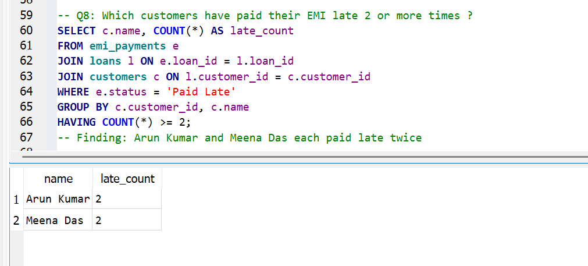
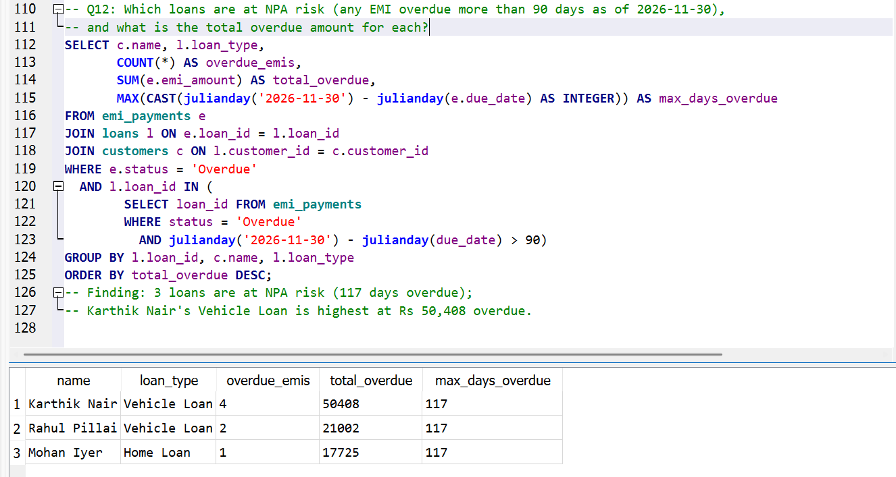

# Banking Operations Support Analysis (SQL)
## About
A SQL Project that simulates a production support investigation at a small bank. Using SQL queries, it finds failed transactions, overdue EMIs, duplicate debits and KYC-related risks, with the business question and finding documented for each query. 

## Database
4 tables: customers, loans, emi_payments, transactions (112 records in total). 
Dataset: synthetic data created for practice, with deliberately planted problems (duplicates, overdue EMIs, pending-KYC customers). No real customer information. 

## Tools 
SQL (SQLite), DB Browser for SQLite, GitHub

## Key Findings
1. UPI accounts for 12 of the 13 failed transactions. Its failure rate is 46.2%, compared with 14.3% for IMPS and 0% for NEFT. Timeout is the top failure reason (7 of 13). 
2. 13 EMIs are overdue. 3 of them are over 90 days old (Rs 40,828), so those 3 loans are at NPA risk. 
3. Vehicle Loans have the highest overdue amount (6 overdue EMIs, Rs 71,410). 
4. 3 customers were charged the same amount twice within 1-2 minutes (possible duplicate debits). 
5. 4 high-value transactions (Rs 78,000 to 95,000) came from customers with Pending or Expired KYC. 

## Files
- setup.sql : creates the 4 tables and loads the data 
- queries.sql : the 12 queries, each with the business question and finding
- bank_support.db : the SQLite database
- screenshots/: query output for each query

## Sample Output

## Skills Shown 
JOINs, GROUP BY, HAVING, CASE WHEN, aggregate functions, subqueries, date calculations (aging buckets), duplicate detection. 